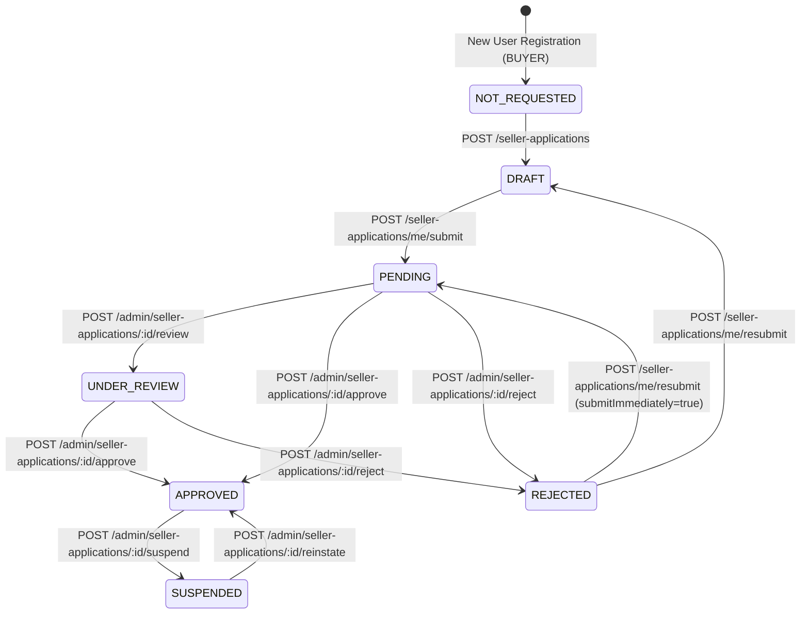

# 01 — Account Lifecycle (Unified Buyer & Seller Identity)

## Overview

Deal One uses a **single unified `User` identity** (`users` table) for both buyer and seller capabilities. No separate user account is ever created when a buyer converts to a seller.

- **Default Registration State**: Every newly registered user via OTP (`POST /api/v1/auth/otp/verify`) starts strictly as a **BUYER**:
  - `user.sellerStatus = "NOT_REQUESTED"`
  - `roles = ["BUYER"]`
  - `canSell = false`
  - `activeAccount = null` (no seller `Account` is auto-created on registration)
- **Seller Capability Activation**: Granted **only** after an authorized administrator approves a complete `SellerApplication` in a single atomic database transaction.
- **Buyer Capability Preservation**: Converting to a seller, having an application rejected, or having seller privileges suspended **never** removes buyer permissions. Account-level moderation (`User.isActive`, `User.moderationStatus`, `User.bannedAt`, `User.suspendedUntil`) remains strictly separated from seller-level status (`User.sellerStatus`).

## Seller Status Lifecycle

| Status | Description | Buyer Capabilities | Seller Capabilities |
|---|---|---|---|
| `NOT_REQUESTED` | Default state for every new user (BUYER). | Active | Blocked |
| `DRAFT` | Buyer initiated conversion; editing info & uploading private KYC documents. | Active | Blocked |
| `PENDING` | Complete application submitted; awaiting admin review. | Active | Blocked |
| `UNDER_REVIEW` | Admin/verification officer actively reviewing application & documents. | Active | Blocked |
| `APPROVED` | Admin verified application; seller `Account` active (`verificationStatus = "approved"`). | Active | **Active** |
| `REJECTED` | Admin rejected with mandatory reason; buyer may reopen (`DRAFT`) or resubmit (`PENDING`). | Active | Blocked |
| `SUSPENDED` | Admin revoked seller privileges with mandatory reason; `User.isActive` remains `true`. | Active | Blocked |

## Allowed State Transitions

Enforced by `SELLER_APPLICATION_TRANSITIONS` in `src/modules/accounts/seller-application-state-machine.ts`:

Any arbitrary transition outside this graph (e.g., `DRAFT -> APPROVED`, `REJECTED -> APPROVED`, `APPROVED -> PENDING`, `NOT_REQUESTED -> APPROVED`) is rejected with HTTP `400 Bad Request` (`INVALID_SELLER_STATUS_TRANSITION`).
