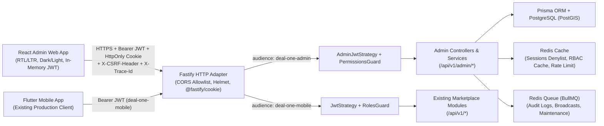

# 06 — Target Architecture (React Admin Dashboard ↔ NestJS Backend)

> **Frontend Stack Chosen by User:** **React** (TypeScript, Tailwind CSS, shadcn/ui, TanStack Query, TanStack Table, React Hook Form, Zod, Recharts, Vitest, Playwright)  
> **Backend Runtime:** Existing NestJS + Fastify Modular Monolith (`/api/v1/admin/*`)  
> **Mobile Preservation Guarantee:** Zero breaking changes to `/api/v1/*` mobile contracts or `JwtStrategy` (`deal-one-mobile`).

---

## 1. High-Level System Architecture



---

## 2. React Admin Frontend Architecture

Even though Phase 00 covers discovery before frontend scaffolding, the Backend API is designed specifically around the following **React feature-based modular architecture**:

```text
admin-web/
├── src/
│   ├── app/                  # Router, Providers (QueryClient, Theme, i18n RTL/LTR, AuthBoundary)
│   ├── features/             # 16 isolated domain modules + auth
│   │   ├── auth/             # Login, MFA challenge, password reset, active sessions
│   │   ├── dashboard/        # Overview KPIs & Recharts visualizations
│   │   ├── users/            # Users & Seller Accounts management
│   │   ├── listings/         # Listings table, detail drawer, moderation & bulk actions
│   │   ├── categories/       # Taxonomy tree & dynamic category fields editor
│   │   ├── moderation/       # Abuse reports queue, staff assignment & moderation logs
│   │   ├── verifications/    # Seller KYC / business verification review
│   │   ├── notifications/    # Targeted & broadcast notifications composer
│   │   ├── cms/              # Banners, announcements, static pages
│   │   ├── chat-oversight/   # Read-only audited dispute conversation viewer
│   │   ├── analytics/        # Growth, SLA, revenue & CSV exports
│   │   ├── admins/           # Staff users management
│   │   ├── roles/            # Roles & granular permission matrix editor
│   │   ├── audit-logs/       # Immutable audit explorer & diff viewer
│   │   ├── system-health/    # DB, Redis, BullMQ queues, Workers & Email readiness
│   │   ├── feature-flags/    # Dynamic feature flag toggles
│   │   └── settings/         # Platform key-value JSON settings
│   ├── components/           # Shared UI primitives (shadcn/ui, DataTable, ConfirmDialog, Shell)
│   ├── core/
│   │   ├── api/              # Centralized HTTP client (refresh queue, timeout, cancel, error norm)
│   │   ├── auth/             # In-memory token store & PermissionGate component
│   │   ├── config/           # Env validation (Zod)
│   │   └── i18n/             # Arabic (RTL) & English (LTR) dictionaries
│   ├── hooks/                # Debounce, pagination URL sync, RTL/theme hooks
│   ├── types/                # Shared TS contracts matching Backend DTOs
│   ├── schemas/              # Zod schemas matching Backend class-validator DTOs
│   └── tests/                # Vitest unit & MSW integration tests
└── e2e/                      # Playwright end-to-end RBAC, RTL & auth tests
```

---

## 3. React ↔ NestJS Authentication & Session Security Design

### 3.1 Dual-Token Transport (Zero `localStorage` Refresh Token Exposure)
1. **Access Token (`15m` TTL, JWT HS256):**
   - Returned in the JSON response body (`data.accessToken`) from `/admin/auth/login`, `/admin/auth/mfa/verify`, and `/admin/auth/refresh`.
   - Stored **strictly in React memory** (closure/module variable or React Auth Context ref — **never** in `localStorage`, `sessionStorage`, or `document.cookie`).
   - Sent via `Authorization: Bearer <accessToken>` on every `/api/v1/admin/*` request.
2. **Refresh Token (`7d` TTL, 40-byte CSPRNG hex):**
   - Stored **only** in a backend-set `HttpOnly` cookie:
     - Cookie name: `dealone_admin_rt`
     - Attributes: `HttpOnly; SameSite=Strict; Path=/api/v1/admin/auth; Secure` (`Secure: true` in production / HTTPS; configurable for `http://localhost` dev).
   - **Never** readable by JavaScript in React (`document.cookie` cannot access it).
   - On page reload (`F5`), React calls `POST /api/v1/admin/auth/refresh` with `credentials: 'include'` + anti-CSRF header to silently obtain a fresh in-memory `accessToken` and rotate the `HttpOnly` cookie.
3. **CSRF Defense for Cookie Endpoints:**
   - All cookie-consuming endpoints (`/admin/auth/refresh`, `/admin/auth/logout`) verify:
     1. Strict `Origin` header match against `CORS_ORIGIN` allowlist in production.
     2. Custom header requirement: `X-Requested-With: dealone-admin-web` (or double-submit CSRF cookie `dealone_admin_csrf` echoed in `X-CSRF-Token` header).

### 3.2 Centralized React API Client Contract
The React `apiClient` layer implements:
- **Normalized Unwrapping:** Automatically unwraps `{ success: true, data, meta }` and normalizes `{ success: false, error: { code, message, details, trace_id } }` into a typed `ApiClientError`.
- **Single-Flight Refresh Queue:** If multiple parallel TanStack Query calls receive `401 Unauthorized`, only **one** `POST /admin/auth/refresh` call executes while pending requests wait and retry with the new in-memory token.
- **Request Cancellation & Timeout:** Passes `AbortSignal` from TanStack Query (`queryFn({ signal })`) combined with a default 25-second timeout (`AbortSignal.timeout` / `AbortController`), safely under Fastify's `30_000ms` `requestTimeout`.
- **Server-Side Pagination / Sorting / Filtering:** Standard query params (`page`, `limit`, `sortBy`, `sortOrder`, `q`, plus domain filters) returning `{ items, meta: { total, page, limit, totalPages } }` (or existing module payload normalized cleanly).

---

## 4. Backend Isolation Boundaries

| Boundary | Mobile (`Flutter`) | Admin (`React`) |
| :--- | :--- | :--- |
| **Route Namespace** | `/api/v1/*` (excluding `/api/v1/admin/*`) | `/api/v1/admin/*` |
| **User Table** | `users` (`User`) | `staff_users` (`StaffUser`) |
| **Session Table** | `user_sessions` (`UserSession`) | `staff_sessions` (`StaffSession`) |
| **Passport Strategy** | `JwtStrategy` (`'jwt'`, `aud: 'deal-one-mobile'`) | `AdminJwtStrategy` (`'admin-jwt'`, `aud: 'deal-one-admin'`) |
| **Auth Guard** | `JwtAuthGuard` + `AccountTenantGuard` | `AdminJwtAuthGuard` + `PermissionsGuard` |
| **Refresh Transport** | JSON body (`FlutterSecureStorage`) | `HttpOnly` cookie `dealone_admin_rt` |
| **CORS** | Native mobile (no `Origin` header) | Explicit React Admin origin allowlist (`CORS_ORIGIN`) with `credentials: true` |

> **Important Note on Existing `/api/v1/admin/*` Routes:** Currently `CategoriesController` (`AdminCategoriesController`), `ModerationController`, `PlatformSettingsController`, and `StaffController` use `@UseGuards(JwtAuthGuard, RolesGuard)` which validates against `users` (`deal-one-mobile`). Switching them to `AdminJwtAuthGuard` + `PermissionsGuard` (while keeping exact URL paths) fixes the broken `StaffUser` authentication flow without breaking any Flutter client (because Flutter does not consume admin staff/moderation dashboards in production).
