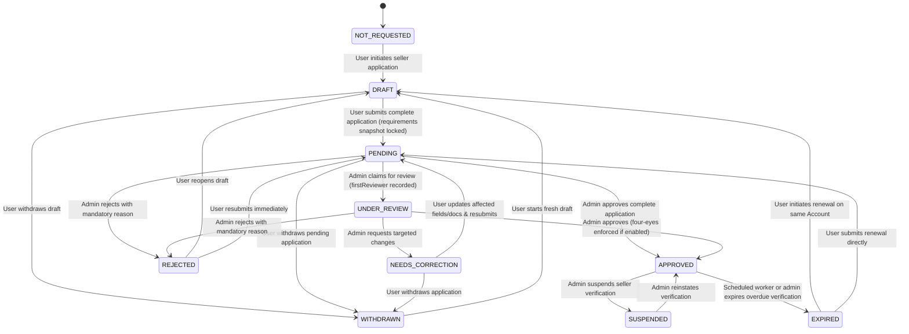
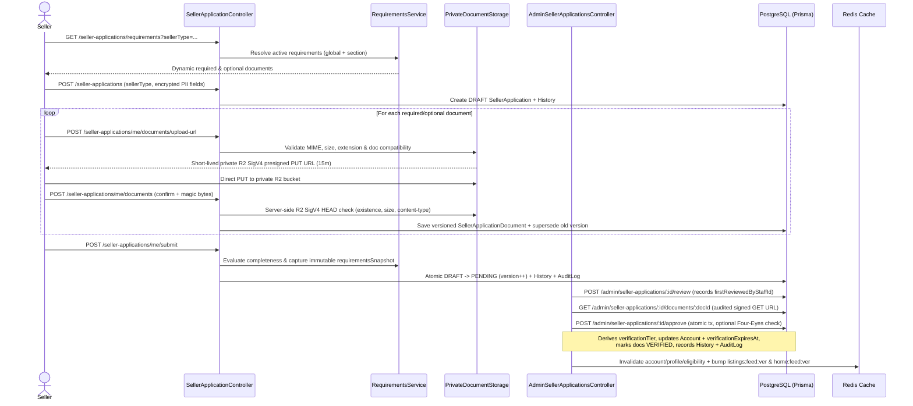
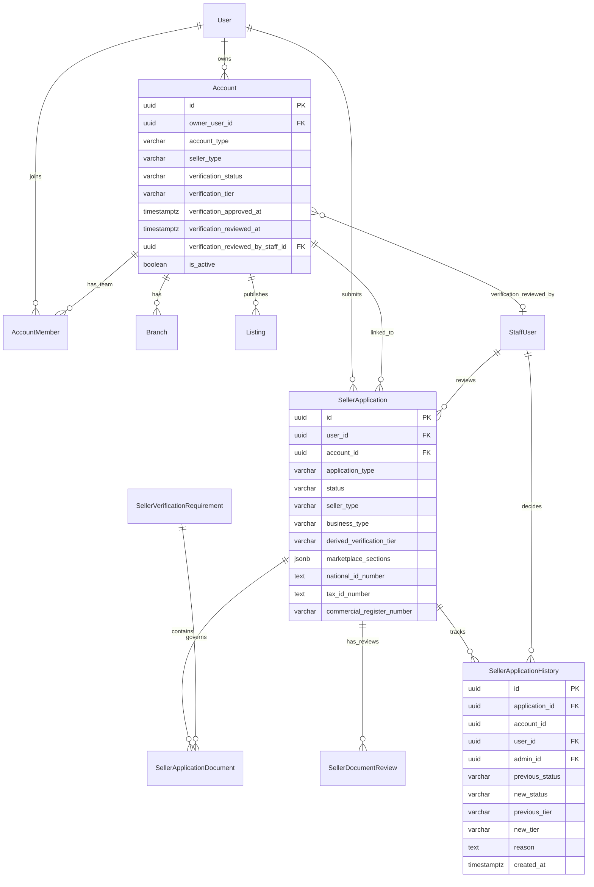

# Deal One Backend Blueprint — Seller Identity & Business Verification System

> **Status:** Production-Ready  
> **Architecture:** Modular Monolith (NestJS + Fastify + Prisma + PostgreSQL + Dual Redis + Private R2 Object Storage)  
> **Scope:** Seller Classification, Identity & Business Verification Tiers, Configurable Requirements Engine, Individual-to-Business Account Upgrade, RBAC & Audit Governance, and Public Badge Serialization.

---

## 1. Seller Verification Business Rules

Deal One enforces a strict separation between **Seller Classification (`sellerType`)** and **Verification Level (`verificationTier`)**:

| Seller Classification (`sellerType`) | Target Persona | Default Required Documents | Derived Verification Tier (on Approval) | Public Arabic Badge |
| :--- | :--- | :--- | :--- | :--- |
| `INDIVIDUAL` | Individuals, independent real estate brokers, freelancers, home sellers | `national_id_front`, `national_id_back` | `IDENTITY_VERIFIED` | **هوية موثقة** |
| `BUSINESS` | Companies, real estate offices, agencies, stores, showrooms, factories | `commercial_register`, `tax_card` *(Legal Rep ID is configurable via admin requirements)* | `BUSINESS_VERIFIED` | **شركة / مكتب موثق** |
| `SERVICE_PROVIDER` | Independent technicians, engineers, contractors, professionals | Follows `INDIVIDUAL` baseline (`national_id_front`, `national_id_back`); extensible with section-specific professional licenses | `IDENTITY_VERIFIED` | **هوية موثقة** |

### Core Trust & Security Invariants

1. **Buyer-First Registration:** Every newly registered user starts strictly as a buyer (`sellerStatus = NOT_REQUESTED`, `verificationTier = NONE`, `verificationBadge = null`).
2. **Server-Derived Verification Tier:** `verificationTier` is ALWAYS computed server-side by `deriveVerificationTier()` from the approved seller classification and verified supporting documents. Client-supplied `verificationTier` values are rejected (`ValidationPipe` with `forbidNonWhitelisted: true`).
3. **No Badge Without Active Approval:** Accounts in `NOT_SUBMITTED`, `DRAFT`, `PENDING`, `UNDER_REVIEW`, `NEEDS_CORRECTION` (`needs_changes`), `REJECTED`, `SUSPENDED`, or `EXPIRED` status ALWAYS resolve to `verificationTier = NONE` and `verificationBadge = null`.
4. **Optional Documents Never Block:** Optional requirements (`isRequired = false`, such as Proof of Address, Legal Representative ID by default, Business License by default, and Additional Documents) never block submission or admin approval.
5. **Logo Always Optional:** `Account.logoUrl` remains optional across all seller types.
6. **Branch & Team Extensibility:** Business Verified accounts seamlessly integrate with existing `Branch`, `ServiceArea`, and `AccountMember` modules without granting automatic unlimited quotas or paid entitlements.

---

## 2. Verification State Machine



### Verification Workflow Sequence



---

## 3. Database Schema and Relationships



### Default Configurable Requirements (`seller_verification_requirements`)

| Seller Type | Document Type | Required by Default | Notes |
| :--- | :--- | :---: | :--- |
| `INDIVIDUAL` | `national_id_front` | **Yes** | Global baseline |
| `INDIVIDUAL` | `national_id_back` | **Yes** | Global baseline |
| `INDIVIDUAL` | `proof_of_address` | No | Required in `real-estate` section |
| `INDIVIDUAL` | `additional_document` | No | Optional supporting file |
| `BUSINESS` | `commercial_register` | **Yes** | Global baseline |
| `BUSINESS` | `tax_card` | **Yes** | Global baseline |
| `BUSINESS` | `national_id_front` | **Configurable (No)** | Legal Representative ID — toggleable via Admin API |
| `BUSINESS` | `legal_representation_proof` | No | Optional power of attorney |
| `BUSINESS` | `proof_of_address` | No | Required in `building-materials` section |
| `BUSINESS` | `business_license` | No | Required in `real-estate` and `cars` sections |
| `BUSINESS` | `additional_document` | No | Optional supporting file |
| `SERVICE_PROVIDER` | `national_id_front` | **Yes** | Follows `INDIVIDUAL` baseline |
| `SERVICE_PROVIDER` | `national_id_back` | **Yes** | Follows `INDIVIDUAL` baseline |
| `SERVICE_PROVIDER` | `qualification_certificate` | No | Required in `services` section |
| `SERVICE_PROVIDER` | `portfolio_document` | No | Optional work samples |
| `SERVICE_PROVIDER` | `additional_document` | No | Optional supporting file |

Seeding is idempotent per `(sellerType, marketplaceSection, documentType)` and **never overwrites** existing admin-customized requirements.

---

## 4. API Endpoints and Examples

### Seller Endpoints (`/api/v1/seller-applications`)

| Method | Endpoint | Purpose |
| :--- | :--- | :--- |
| `GET` | `/api/v1/seller-applications/requirements` | Dynamically fetch required/optional documents by `sellerType` & `marketplaceSection(s)` |
| `POST` | `/api/v1/seller-applications` | Create `DRAFT` initial seller application |
| `GET` | `/api/v1/seller-applications/me` | Get seller status, `verificationTier`, `verificationBadge`, capabilities, and active application |
| `PATCH` | `/api/v1/seller-applications/me` | Update draft or admin-specified correction fields |
| `POST` | `/api/v1/seller-applications/me/documents/upload-url` | Issue short-lived private presigned PUT URL (validates MIME, size, extension, doc compatibility) |
| `POST` | `/api/v1/seller-applications/me/documents` | Confirm uploaded document (magic-byte check + version preservation) |
| `PUT` | `/api/v1/seller-applications/me/documents/:documentId/replace` | Replace document (preserves audit version history) |
| `GET` | `/api/v1/seller-applications/me/documents/:documentId/access` | Owner-only short-lived signed GET URL |
| `POST` | `/api/v1/seller-applications/me/submit` | Submit complete initial application (`DRAFT -> PENDING`) |
| `POST` | `/api/v1/seller-applications/me/resubmit` | Resubmit `NEEDS_CORRECTION`, `REJECTED`, or `EXPIRED` application |
| `POST` | `/api/v1/seller-applications/me/business-upgrade` | Initiate Individual-to-Business upgrade (`BUSINESS_UPGRADE` draft linked to existing `accountId`) |
| `GET` | `/api/v1/seller-applications/me/business-upgrade` | View business upgrade status, eligibility, and business requirements |
| `POST` | `/api/v1/seller-applications/me/business-upgrade/submit` | Submit business upgrade for review (keeps active `IDENTITY_VERIFIED` status while pending) |
| `POST` | `/api/v1/seller-applications/me/business-upgrade/resubmit` | Resubmit rejected or needs-correction business upgrade |

### Admin Endpoints (`/api/v1/admin/seller-applications`)

| Method | Endpoint | Required Permission(s) |
| :--- | :--- | :--- |
| `GET` | `/api/v1/admin/seller-applications` | `verification.read` |
| `GET` | `/api/v1/admin/seller-applications/:id` | `verification.read` |
| `GET` | `/api/v1/admin/seller-applications/:id/history` | `verification.read` |
| `GET` | `/api/v1/admin/seller-applications/:id/documents/:documentId` | `verification.documents.read` |
| `POST` | `/api/v1/admin/seller-applications/:id/review` | `verification.review` \| `verification.approve` \| `verification.reject` |
| `POST` | `/api/v1/admin/seller-applications/:id/documents/:documentId/review` | `verification.review` \| `verification.approve` \| `verification.reject` |
| `POST` | `/api/v1/admin/seller-applications/:id/request-correction` | `verification.require_changes` \| `verification.reject` \| `verification.approve` |
| `POST` | `/api/v1/admin/seller-applications/:id/approve` | `verification.approve` |
| `POST` | `/api/v1/admin/seller-applications/:id/reject` | `verification.reject` |
| `POST` | `/api/v1/admin/seller-applications/:id/suspend` | `verification.suspend` \| `verification.reject` \| `users.suspend` |
| `POST` | `/api/v1/admin/seller-applications/:id/reinstate` | `verification.approve` |
| `GET/POST/PATCH/DELETE` | `/api/v1/admin/seller-applications/requirements` | `verification.read` / `verification.requirements.manage` |

### Public Verification Badge Example (Accounts, Listings, Search)

```json
{
  "seller": {
    "id": "8e3b9f12-4a2b-4c3d-9e5f-112233445566",
    "name": "مكتب النيل للعقارات",
    "slug": "el-nile-real-estate",
    "accountType": "office",
    "sellerType": "BUSINESS",
    "verificationStatus": "APPROVED",
    "verificationTier": "BUSINESS_VERIFIED",
    "verificationBadge": {
      "code": "BUSINESS_VERIFIED",
      "label": "شركة / مكتب موثق"
    },
    "logoUrl": null
  }
}
```

---

## 5. Admin Permissions

All permissions are defined in `ADMIN_PERMISSION_CATALOG` (`admin-permissions.constant.ts`) and enforced by `AdminJwtAuthGuard` + `PermissionsGuard`:

- `verification.read` — View seller verification queues, details, and history.
- `verification.review` — Claim applications (`PENDING -> UNDER_REVIEW`) and review individual documents.
- `verification.approve` — Approve applications and upgrades; reinstate suspended sellers.
- `verification.reject` — Reject applications with a mandatory reason.
- `verification.require_changes` — Request targeted field/document corrections (`NEEDS_CORRECTION`).
- `verification.suspend` — Suspend active seller verifications and revoke active badges.
- `verification.requirements.manage` — Create, update, version, and deactivate configurable document requirements.
- `verification.documents.read` — Audited access to short-lived private signed document URLs.

---

## 6. Document Storage and Security

- **Isolated Private Bucket:** All KYC and commercial documents are stored exclusively under `private/seller-verification/<userId>/<applicationId>/<uuid>.<ext>` in a dedicated private R2 bucket (`R2_PRIVATE_BUCKET_NAME`), completely isolated from public listing media (`R2_PUBLIC_DOMAIN`).
- **Multi-Layer File Validation:** Enforces MIME type allowlist, per-requirement file size ceiling (max 25 MB global cap), filename extension matching declared MIME type, base64 magic-byte signature verification, storage-key ownership & traversal checks, and document-type compatibility per `sellerType`.
- **Encryption at Rest:** Sensitive identity numbers (`nationalIdNumber`, `taxIdNumber`, `authorizedRepresentativeId`) are encrypted using AES-256-GCM (`SensitiveDataCryptoService`) and masked in all API responses.
- **Zero Public Leakage:** Public endpoints (`/accounts/:id`, `/listings`, `/listings/:id`, `/search/listings`) explicitly project only safe seller fields and never expose `storageKey`, private document URLs, rejection reasons, internal admin notes, or `verificationReviewedByStaffId`.
- **Anti-Abuse Controls:** Self-approval prevention (`assertNotSelfAction`), optimistic concurrency locking on status transitions, rate limiting on upload/submission endpoints, and immutable audit trails (`SellerApplicationHistory`, `AuditLog`, `ModerationLog`) capturing `accountId`, `reviewerId`, `previousStatus`, `newStatus`, `previousTier`, `newTier`, `reason`, and `timestamp`.

---

## 7. Individual-to-Business Upgrade Workflow

```mermaid
sequenceDiagram
    actor Seller as Identity-Verified Seller
    participant API as SellerApplicationController
    participant Admin as Verification Officer
    participant DB as PostgreSQL (Single Account)
    participant Cache as Redis Cache

    Note over Seller,DB: Existing Account: id=A1, sellerType=INDIVIDUAL,<br/>verificationTier=IDENTITY_VERIFIED, active listings & chats
    Seller->>API: POST /seller-applications/me/business-upgrade
    API->>DB: Create BUSINESS_UPGRADE DRAFT linked to accountId=A1
    Note over DB: Account A1 stays INDIVIDUAL & IDENTITY_VERIFIED
    Seller->>API: Upload commercial_register + tax_card
    Seller->>API: POST /seller-applications/me/business-upgrade/submit
    Note over DB: Upgrade is PENDING; Account A1 & listings remain active!
    Admin->>DB: POST /admin/seller-applications/:upgradeId/approve (atomic tx)
    Note over DB: Updates Account A1 in-place:<br/>sellerType=BUSINESS, verificationTier=BUSINESS_VERIFIED.<br/>Preserves accountId, listings, conversations, messages, favorites!
    Admin->>Cache: Invalidate account & listings:feed:* caches
```

---

## 8. Migration and Deployment Notes

1. **Migration:** `20261126000002_add_verification_tiers_and_business_upgrade`
   - Adds `seller_type`, `verification_tier`, `verification_approved_at`, `verification_reviewed_at`, `verification_reviewed_by_staff_id` to `accounts`.
   - Adds `application_type` and `derived_verification_tier` to `seller_applications`, updating the active partial unique index to `(user_id, application_type)`.
   - Adds `account_id`, `previous_tier`, `new_tier` to `seller_application_history`.
   - **Conservative Evidence-Based Backfill:** Backfills `BUSINESS_VERIFIED` ONLY when an approved `BUSINESS` application has both `commercial_register` and `tax_card` documents; backfills `IDENTITY_VERIFIED` ONLY when an approved `INDIVIDUAL`/`SERVICE_PROVIDER` application has both `national_id_front` and `national_id_back` documents. Ambiguous legacy accounts remain `NONE` until reviewed.
2. **Deployment Steps:**
   - Run `npm run prisma:migrate:deploy`
   - Run `npm run prisma:seed:admin` (syncs new verification RBAC permissions to system roles)
   - Start/restart backend service (`SellerVerificationRequirementsService.onModuleInit` idempotently seeds any missing default requirements without overwriting admin customizations).

---

## 9. Test Coverage

- **Unit Tests:** `src/modules/accounts/verification-tier-and-upgrade.spec.ts`, `src/modules/accounts/services/seller-application.service.spec.ts`, `src/modules/accounts/services/seller-verification-security.spec.ts`, `src/modules/accounts/seller-application-state-machine.spec.ts`, `src/modules/accounts/guards/seller-authorization.guard.spec.ts`.
- **Integration & Security E2E Tests:** `test/seller-verification-tiers-and-upgrade.e2e-spec.ts`, `test/seller-verification.e2e-spec.ts`, `test/seller-verification-identity-review.e2e-spec.ts`.
- **Swagger / OpenAPI:** Automatically generated from NestJS `@ApiOperation`, `@ApiResponse`, `@ApiProperty` decorators at `/api/docs` when `ENABLE_SWAGGER=true`.


---

## 9. Hardening Controls (Encryption, Four-Eyes, Retention, Scheduled Jobs & Cache)

### 9.1 AES-256-GCM Encryption & Versioned Key Rotation (`SensitiveDataCryptoService`)
- **Encrypted fields at rest:** `nationalIdNumber`, `taxIdNumber`, `commercialRegisterNumber`, and `authorizedRepresentativeId`.
- **Ciphertext format:** `enc:<keyVersion>:<12-byte-iv-hex>:<16-byte-gcm-tag-hex>:<ciphertext-hex>` (unique random 96-bit IV per encryption).
- **Key Rotation:** Configure `SELLER_PII_ENCRYPTION_KEYS="v1:<oldKey>,v2:<newKey>"` and `SELLER_PII_ENCRYPTION_KEY_VERSION="v2"`. Existing `v1` records and legacy plaintext rows remain decryptable while all new writes encrypt with `v2`. Use `needsReencryption()` / `reencrypt()` for offline re-encryption.
- **Zero PII Leakage:** Raw values, keys, and ciphertexts are never logged. Standard API responses return masked values (`**********4567`, or `********` on unknown key version).

### 9.2 Configurable Four-Eyes Review (`ENABLE_FOUR_EYES_VERIFICATION_REVIEW`)
- Self-approval is **always** blocked (`403 SELF_APPROVAL_FORBIDDEN`).
- When `ENABLE_FOUR_EYES_VERIFICATION_REVIEW=true`, the staff member who starts review or reviews the first document (`firstReviewedByStaffId`) cannot perform the final approval (`403 FOUR_EYES_APPROVAL_REQUIRED`); a second authorized admin must approve.

### 9.3 Authoritative State Transition Matrix & Account Mapping

| From State | Allowed To States | Actor | Account `verificationStatus` | Account `verificationTier` |
| :--- | :--- | :--- | :--- | :--- |
| `DRAFT` | `PENDING`, `WITHDRAWN` | Seller | `not_submitted` | `NONE` |
| `PENDING` | `UNDER_REVIEW`, `APPROVED`, `REJECTED`, `WITHDRAWN` | Admin / Seller | `pending` | `NONE` |
| `UNDER_REVIEW` | `NEEDS_CORRECTION`, `APPROVED`, `REJECTED` | Admin | `pending` | `NONE` |
| `NEEDS_CORRECTION` | `PENDING`, `WITHDRAWN` | Seller | `needs_changes` | `NONE` |
| `REJECTED` | `DRAFT`, `PENDING` | Seller | `rejected` | `NONE` |
| `WITHDRAWN` | `DRAFT`, `PENDING` | Seller | `not_submitted` *(preserved on upgrade)* | `NONE` *(preserved on upgrade)* |
| `APPROVED` | `SUSPENDED`, `EXPIRED` | Admin / Worker | `approved` | `IDENTITY_VERIFIED` / `BUSINESS_VERIFIED` |
| `SUSPENDED` | `APPROVED` | Admin | `suspended` | `NONE` |
| `EXPIRED` | `DRAFT`, `PENDING` | Seller | `expired` | `NONE` |

### 9.4 Configurable Document Retention & Purge Policy

| Document Category | Env Variable | Default | Notes |
| :--- | :--- | :--- | :--- |
| Rejected application / document | `VERIFICATION_DOC_RETENTION_REJECTED_DAYS` | `90` days | Purges R2 object & redacts filename; preserves audit row |
| Withdrawn application | `VERIFICATION_DOC_RETENTION_WITHDRAWN_DAYS` | `30` days | Purges R2 object & redacts filename |
| Expired verification | `VERIFICATION_DOC_RETENTION_EXPIRED_DAYS` | `180` days | Purges R2 object & redacts filename |
| Superseded document version | `VERIFICATION_DOC_RETENTION_SUPERSEDED_DAYS` | `90` days | Purges replaced version after retention window |
| Approved verification | `VERIFICATION_DOC_RETENTION_APPROVED_DAYS` | `0` (keep) | Configurable when legal retention period is finalized |
| Orphan `PENDING_UPLOAD` | `VERIFICATION_ORPHAN_UPLOAD_TTL_HOURS` | `24` hours | Deletes unconfirmed R2 uploads |

> **Safety Invariant:** Documents belonging to applications in `PENDING`, `UNDER_REVIEW`, or `NEEDS_CORRECTION` status are **never** purged by retention cleanup.

### 9.5 Scheduled Maintenance Jobs (`SellerVerificationMaintenanceProcessor`)
Registered in `WorkerService` using **BullMQ repeatable jobs** (with Redis distributed-lock interval fallback when BullMQ is offline):
1. `verification-expiry` (every 1h): Expires overdue `APPROVED` verifications (`verificationExpiresAt <= now`), sets `Account.verificationStatus = 'expired'`, `verificationTier = 'NONE'`, revokes badge, invalidates Redis caches, notifies seller.
2. `verification-renewal-reminders` (every 12h): Sends idempotent `SELLER_VERIFICATION_EXPIRING_SOON` push notifications `VERIFICATION_RENEWAL_REMINDER_DAYS` (default 30) before expiry.
3. `verification-doc-retention` (every 6h): Deletes expired & orphaned private R2 objects via SigV4 `DELETE`, marks `status = 'PURGED'`, `purgedAt = now`, redacts filename, preserves audit trail.

### 9.6 Redis Cache Invalidation
Every verification state transition calls `invalidateAccountCache(userId, accountId)`:
- `DEL account:membership:<userId>:<accountId>`
- `INCR listings:feed:ver` and `INCR home:feed:ver`
- Non-blocking `SCAN` (`delByPattern`) for `listings:feed:*`, `account:public:<accountId>*`, `account:profile:<accountId>*`, `seller:profile:<accountId>*`, `seller:eligibility:<userId>*`.
