# 01 — System Context Diagram

## Overview

The System Context diagram shows the **Deal One Platform** as a black-box boundary, its real human actors, client applications, internal data/storage systems, and external third-party gateways verified in `backend/src/core/config/env.config.ts` and `backend/src/app.module.ts`.

## Diagram

```mermaid
flowchart TB
    subgraph Actors["Platform Actors"]
        Guest["Guest / Unauthenticated User"]
        Buyer["Registered Buyer (USER)"]
        Seller["Seller / Account Member\n(INDIVIDUAL | BUSINESS | SERVICE_PROVIDER)"]
        Staff["Admin / Staff User\n(9 RBAC Roles + MFA)"]
    end

    subgraph Clients["Client Applications"]
        FlutterApp["Deal One Mobile App\n(Flutter + Riverpod + Dio)"]
        AdminWeb["Deal One Admin Dashboard\n(React 18 + Vite + TanStack Query)"]
    end

    subgraph Platform["Deal One Backend Platform (NestJS + Fastify)"]
        API["Deal One REST API\n(/api/v1/*)"]
        Workers["Background Workers\n(BullMQ Maintenance Jobs)"]
    end

    subgraph DataStores["Data & Object Storage"]
        PG[("PostgreSQL 16 + PostGIS 3.4\n(45 Prisma Models)")]
        RedisCache[("Redis Cache\n(Port 6379, LRU)")]
        RedisQueue[("Redis Queue\n(Port 6380, AOF noeviction)")]
        R2Public[("Cloudflare R2 Public Bucket\n(Listing Images / Public Media)")]
        R2Private[("Cloudflare R2 Private Bucket\n(KYC & Commercial Verification Docs)")]
    end

    subgraph External["External Gateways (Verified in Code)"]
        SMS["SMS Misr & WhatsApp Cloud API\n(OTP Delivery)"]
        Resend["Resend API\n(Transactional & Verification Emails)"]
        FCM["Firebase Cloud Messaging (FCM)\n(Push Notifications)"]
        CFStream["Cloudflare Stream\n(Video Upload & Webhooks)"]
        Sentry["Sentry\n(Error Tracking, Optional)"]
        Paymob["Paymob Egypt\n(Feature-Flagged: ENABLE_V2_PAYMENTS=false)"]
    end

    Guest -->|"Browse, Search, View Listings"| FlutterApp
    Buyer -->|"Auth, Favorites, Chat, Bookings, RFQ, Cart"| FlutterApp
    Seller -->|"KYC Verification, Listings, Branches, Quotations"| FlutterApp
    Staff -->|"Moderation, KYC Review, RBAC, CMS, Analytics"| AdminWeb

    FlutterApp -->|"HTTPS REST JSON + Bearer JWT"| API
    FlutterApp -.->|"Direct Presigned PUT/GET"| R2Public
    FlutterApp -.->|"Direct Presigned PUT/GET (Short-Lived SigV4)"| R2Private
    AdminWeb -->|"HTTPS REST JSON + Bearer Admin JWT + HttpOnly Refresh Cookie"| API
    AdminWeb -.->|"Audited Short-Lived Presigned GET"| R2Private

    API -->|"Prisma ORM / SQL + PostGIS"| PG
    API -->|"Cache / Rate Limits / Feed Versions"| RedisCache
    API -->|"Job Enqueue / Distributed Locks"| RedisQueue
    Workers -->|"Prisma ORM"| PG
    Workers -->|"Cache Invalidation"| RedisCache
    Workers -->|"BullMQ Repeatable Jobs"| RedisQueue
    Workers -->|"SigV4 DELETE (Retention Purge)"| R2Private

    API -->|"OTP SMS / WhatsApp"| SMS
    API -->|"Verification & Lifecycle Emails"| Resend
    API -->|"Push Dispatches"| FCM
    Workers -->|"Renewal / Expiry / Outbox Push"| FCM
    API -->|"Direct Upload URLs & Signed Webhooks"| CFStream
    API -.->|"Exception Telemetry"| Sentry
    API -.->|"V2 Promotions (Disabled by Default)"| Paymob

    classDef actor fill:#e3f2fd,stroke:#1565c0,color:#0d47a1
    classDef client fill:#ede7f6,stroke:#4527a0,color:#311b92
    classDef core fill:#e8f5e9,stroke:#2e7d32,color:#1b5e20
    classDef store fill:#fff3e0,stroke:#ef6c00,color:#e65100
    classDef ext fill:#fce4ec,stroke:#ad1457,color:#880e4f

    class Guest,Buyer,Seller,Staff actor
    class FlutterApp,AdminWeb client
    class API,Workers core
    class PG,RedisCache,RedisQueue,R2Public,R2Private store
    class SMS,Resend,FCM,CFStream,Sentry,Paymob ext
```

## How to Read This Diagram

- **Solid arrows (`-->`)** represent active runtime communication paths in the current production architecture.
- **Dashed arrows (`-.->`)** represent direct-to-storage presigned transfers, optional telemetry (`Sentry`), or feature-flagged V2 integrations (`Paymob`).
- **Two Separate R2 Buckets:** Public listing media is served via `R2_PUBLIC_DOMAIN`, whereas sensitive seller KYC documents live exclusively in `R2_PRIVATE_BUCKET_NAME` and are accessible only via short-lived AWS SigV4 presigned URLs.

## Planned / Future (Not Currently Active)

- External Malware/AV Scanning Engine (ClamAV or Cloudflare R2 Security Scan) — currently an unconfigured integration boundary (`PrivateDocumentStorageService.scanDocumentBoundary()`).
- Dedicated WebSocket Gateway for real-time chat typing/presence indicators.
