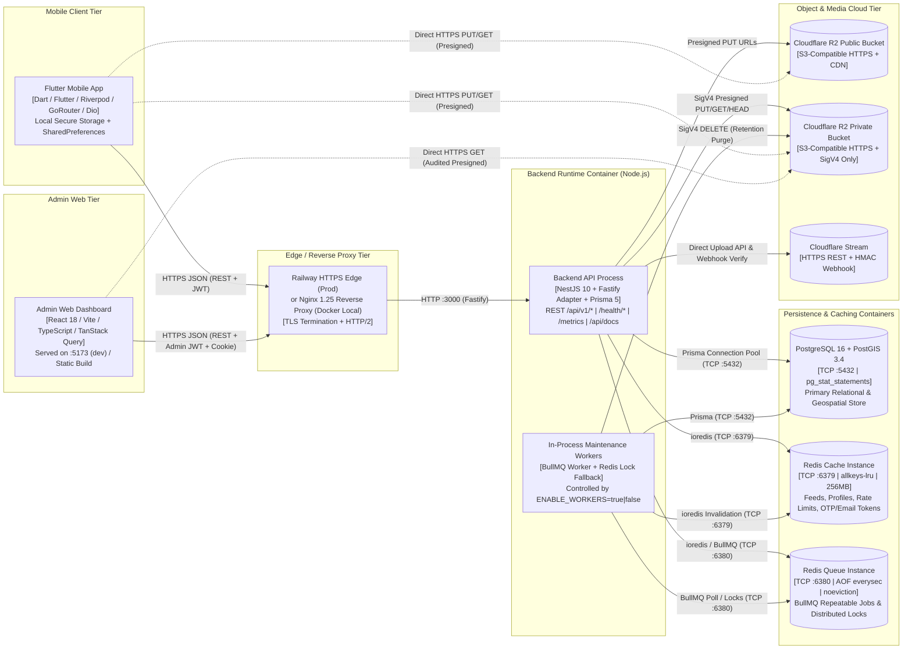

# 02 — C4 Container Diagram

## Overview

This C4 Level-2 Container Diagram details every deployable container in the Deal One platform, its technology stack, and the exact communication protocols verified in `docker-compose.yml`, `railway.json`, `backend/Dockerfile`, `admin-web/package.json`, and `deal one app/pubspec.yaml`.

## Diagram

## Key Container Decisions

1. **Dual-Redis Isolation:** Cache (`6379`, `allkeys-lru`) is separated from Queue (`6380`, `noeviction` + AOF persistence) so cache eviction pressure never drops BullMQ jobs or distributed locks. (In managed single-Redis Railway setups, `REDIS_URL` fallback is supported transparently via `env.config.ts`.)
2. **Worker Isolation Toggle (`ENABLE_WORKERS`):** Workers run in-process by default for simple single-container deployments, and can be split into dedicated worker replicas by setting `ENABLE_WORKERS=false` on API replicas and `ENABLE_WORKERS=true` on worker replicas.
3. **Direct-to-R2 Binary Transfers:** Large images and KYC documents never stream through Fastify memory; the API issues short-lived SigV4 presigned URLs and validates uploads via magic-byte headers and R2 `HEAD` checks.
