# 03 — Backend Architecture Diagram

## Overview

The Deal One backend (`backend/src/`) is a **NestJS Modular Monolith** running on the **Fastify** HTTP adapter. It separates cross-cutting **Core Infrastructure** (`backend/src/core/`) from **25 Domain/Business Modules** (`backend/src/modules/`) and **Background Workers** (`backend/src/workers/`).

## Diagram

```mermaid
flowchart TB
    subgraph HTTP["Fastify HTTP Pipeline"]
        ReqId["RequestIdMiddleware\n(x-request-id + AsyncLocalStorage)"]
        SecPipes["Global ValidationPipe\n(whitelist + forbidNonWhitelisted)"]
        Guards["Guards: JwtAuthGuard | AdminJwtAuthGuard\nPermissionsGuard | SellerAuthorizationGuard\nAccountTenantGuard | RateLimitGuard | MetricsAuthGuard"]
        Interceptors["TransformInterceptor\nStructuredFlowLogger"]
        Filters["HttpExceptionFilter\n(Standard Error Envelope)"]
    end

    subgraph CoreInfra["Core Infrastructure (Global Modules)"]
        Config["ConfigModule\n(Zod env.config.ts)"]
        PrismaMod["PrismaModule\n(PrismaService)"]
        RedisMod["RedisModule\n(RedisService: Cache + Queue + SCAN + Locks)"]
        MetricsMod["MetricsModule\n(Prometheus /metrics)"]
        HealthCtrl["HealthController\n(/health/live, /health/ready)"]
        SecAudit["SecurityAuditService\n(Immutable AuditLog Writer)"]
    end

    subgraph IdentityMods["Identity, Accounts & Verification Modules"]
        AuthMod["AuthModule\n(OTP, Password, JWT, Session Rotation)"]
        EmailMod["EmailModule\n(Resend + EmailVerificationController)"]
        UsersMod["UsersModule\n(User Profile & Settings)"]
        AccountsMod["AccountsModule\n(Accounts, SellerApplication, Requirements,\nPrivateDocumentStorage, SensitiveDataCrypto)"]
    end

    subgraph MarketplaceMods["Core Marketplace Modules"]
        CategoriesMod["CategoriesModule\n(Categories & Dynamic CategoryFields)"]
        LocationsMod["LocationsModule\n(Governorate, City, Area + PostGIS)"]
        ListingsMod["ListingsModule\n(3-Axis State Machine, Contact Reveal)"]
        MediaMod["MediaModule\n(R2 Public Uploads)"]
        VideoMod["VideoModule\n(Cloudflare Stream + Webhooks)"]
        HomeMod["HomeModule\n(Home Feed & Versioned Cache)"]
        SearchMod["SearchModule\n(Full-Text + Trigram + JSONB Filters)"]
        FavoritesMod["FavoritesModule"]
        QuotasMod["QuotasModule\n(DailyQuota Enforcement)"]
    end

    subgraph EngagementMods["Messaging, Notifications & Activity Hub"]
        ChatMod["ChatModule\n(Conversations & Messages REST)"]
        NotifMod["NotificationsModule\n(In-App + FCM Device Tokens)"]
        BookingsMod["BookingsModule\n(Service Bookings)"]
        RfqMod["RfqModule\n(RFQ Requests & Supplier Quotations)"]
        CartMod["CartModule\n(Multi-Seller Cart)"]
        ActivityHubMod["ActivityHubModule\n(Unified Buyer/Seller Activity Feed)"]
    end

    subgraph AdminMods["Enterprise Admin & Governance Modules"]
        AdminAuthMod["AdminAuthModule\n(Staff JWT, HttpOnly Cookie, TOTP MFA, RBAC)"]
        StaffMod["StaffModule\n(Staff Users & Custom Roles)"]
        AdminOpsMod["AdminOperationsModule\n(Dashboard, Analytics, Users, Listings,\nCMS, FeatureFlags, Chat Oversight, Campaigns)"]
        ModerationMod["ModerationModule\n(Reports & Listing Moderation)"]
        SettingsMod["PlatformSettingsModule\n(Dynamic Platform Settings)"]
    end

    subgraph OptionalMods["Feature-Flagged Modules"]
        PaymentsMod["PaymentsModule\n(Paymob V2 — ENABLE_V2_PAYMENTS=true)"]
    end

    subgraph WorkerLayer["Background Workers (WorkerModule — @Global)"]
        WorkerSvc["WorkerService\n(BullMQ + Redis Lock Fallback)"]
        Processors["Processors:\nListingExpiry | MediaCleanup | PaymentReconciliation\nOutboxPublisher | RfqExpiry | Notification\nSellerVerificationMaintenance"]
    end

    HTTP --> IdentityMods
    HTTP --> MarketplaceMods
    HTTP --> EngagementMods
    HTTP --> AdminMods
    HTTP -.->|"If ENABLE_V2_PAYMENTS=true"| OptionalMods

    IdentityMods --> CoreInfra
    MarketplaceMods --> CoreInfra
    EngagementMods --> CoreInfra
    AdminMods --> CoreInfra

    ListingsMod --> AccountsMod
    ListingsMod --> QuotasMod
    ListingsMod --> CategoriesMod
    HomeMod --> ListingsMod
    SearchMod --> ListingsMod
    ActivityHubMod --> BookingsMod
    ActivityHubMod --> RfqMod
    ActivityHubMod --> CartMod
    AccountsMod --> NotifMod
    AccountsMod --> AuthMod
    AccountsMod --> AdminAuthMod
    ChatMod --> NotifMod
    AdminOpsMod --> AdminAuthMod
    AdminOpsMod --> ModerationMod

    WorkerLayer --> CoreInfra
    WorkerLayer --> AccountsMod
    WorkerLayer --> NotifMod
    WorkerSvc --> Processors
```

## Architecture Highlights

- **Strict Validation Boundary:** Global `ValidationPipe` enforces `whitelist: true` and `forbidNonWhitelisted: true`, preventing mass-assignment attacks (such as injecting `verificationTier` or `role`).
- **Dual Auth Stacks:** Marketplace users authenticate via `AuthModule` (`JwtAuthGuard` + `UserSession`), while admin staff authenticate via `AdminAuthModule` (`AdminJwtAuthGuard` + `PermissionsGuard` + `StaffSession` + TOTP MFA).
- **Zero Circular Dependencies:** `WorkerModule` imports `AuthModule`, `NotificationsModule`, and `AccountsModule` cleanly without reverse imports.
