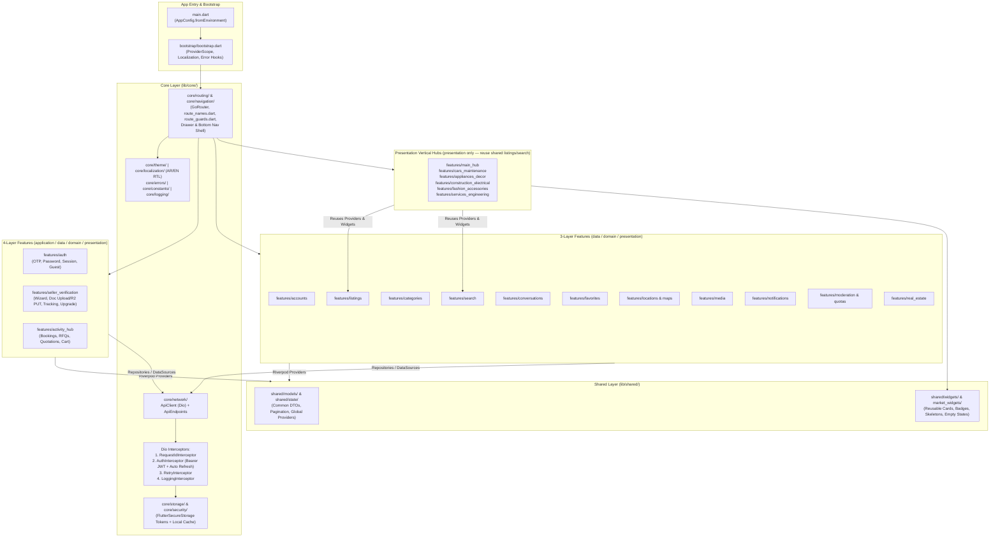

# 04 — Flutter Application Architecture Diagram

## Overview

The Deal One mobile application (`deal one app/lib/`) is built with **Flutter**, **Riverpod** (`flutter_riverpod`) for state management, **Dio** for HTTP networking, and **GoRouter** for declarative navigation and route guards.

As verified in `deal one app/lib/features/`, the app uses **feature-first modularization** with three practical layering depths depending on feature complexity (not every vertical hub duplicates data/domain layers).

## Diagram

## Layering & Error Handling Notes

1. **Single Dio Client:** All features share `core/network/api_client.dart`. `AuthInterceptor` injects `Authorization: Bearer <token>` and handles `401` token refresh transparently via `core/security/` secure storage.
2. **Direct R2 Document Upload:** `features/seller_verification/services/` uses presigned PUT URLs returned by the backend to upload binary KYC documents directly to Cloudflare R2 without sending auth headers to R2.
3. **Localization (AR/EN):** Managed via `lib/l10n/` ARB files and generated delegates (`lib/l10n/generated/`), supporting full RTL layout switching.
4. **Honest Layering Note:** Only `auth`, `seller_verification`, and `activity_hub` contain an explicit `application/` layer; other transactional features use `data/domain/presentation`, and 5 category verticals are thin presentation shells over `listings` and `search`.
