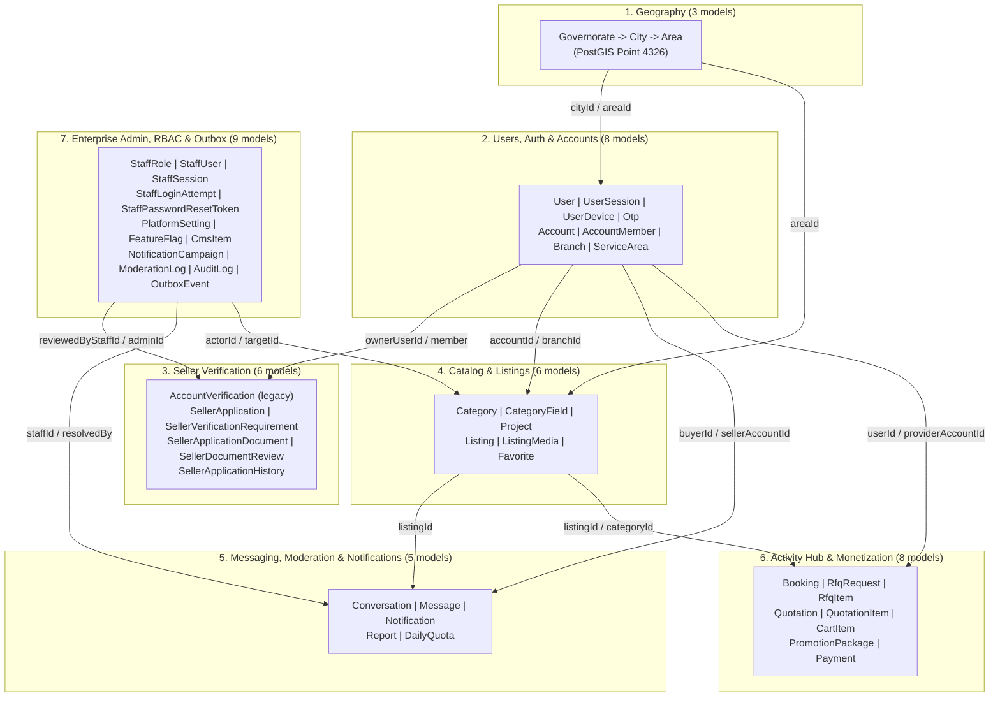

# 05 — Database ERD Overview (45 Prisma Models)

## Overview

`backend/prisma/schema.prisma` defines **45 PostgreSQL models** (with PostGIS `geometry(Point, 4326)` support and 15 applied migrations). To keep the schema readable without omitting any entity, this overview maps all 7 domain groups and their cross-domain foreign-key anchors; detailed entity-level ERDs are in [06-database-erd-domains.md](./06-database-erd-domains.md).

## Domain Relationship Overview

## Model Inventory Count Verification

| Domain Group | Models | Count |
| :--- | :--- | :---: |
| 1. Geography | `Governorate`, `City`, `Area` | 3 |
| 2. Users, Auth & Accounts | `User`, `UserSession`, `UserDevice`, `Otp`, `Account`, `AccountMember`, `Branch`, `ServiceArea` | 8 |
| 3. Seller Verification | `AccountVerification`, `SellerApplication`, `SellerVerificationRequirement`, `SellerApplicationDocument`, `SellerDocumentReview`, `SellerApplicationHistory` | 6 |
| 4. Catalog & Listings | `Project`, `Category`, `CategoryField`, `Listing`, `ListingMedia`, `Favorite` | 6 |
| 5. Messaging, Moderation & Quotas | `Conversation`, `Message`, `Notification`, `Report`, `DailyQuota` | 5 |
| 6. Activity Hub & Monetization | `PromotionPackage`, `Payment`, `Booking`, `RfqRequest`, `RfqItem`, `Quotation`, `QuotationItem`, `CartItem` | 8 |
| 7. Enterprise Admin, RBAC & Outbox | `PlatformSetting`, `StaffRole`, `StaffUser`, `StaffSession`, `StaffLoginAttempt`, `StaffPasswordResetToken`, `FeatureFlag`, `CmsItem`, `NotificationCampaign`, `ModerationLog`, `AuditLog`, `OutboxEvent` | 12 |
| **Total** | *All models in `backend/prisma/schema.prisma`* | **45** *(Note: 3+8+6+6+5+8+9 = 45; `PlatformSetting`/`ModerationLog`/`AuditLog` counted in group 7)* |
