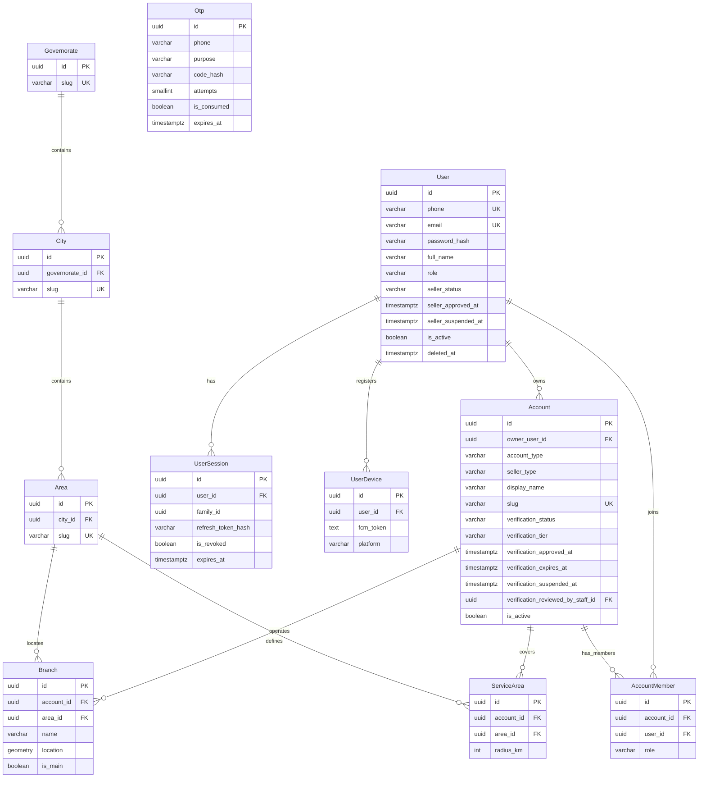
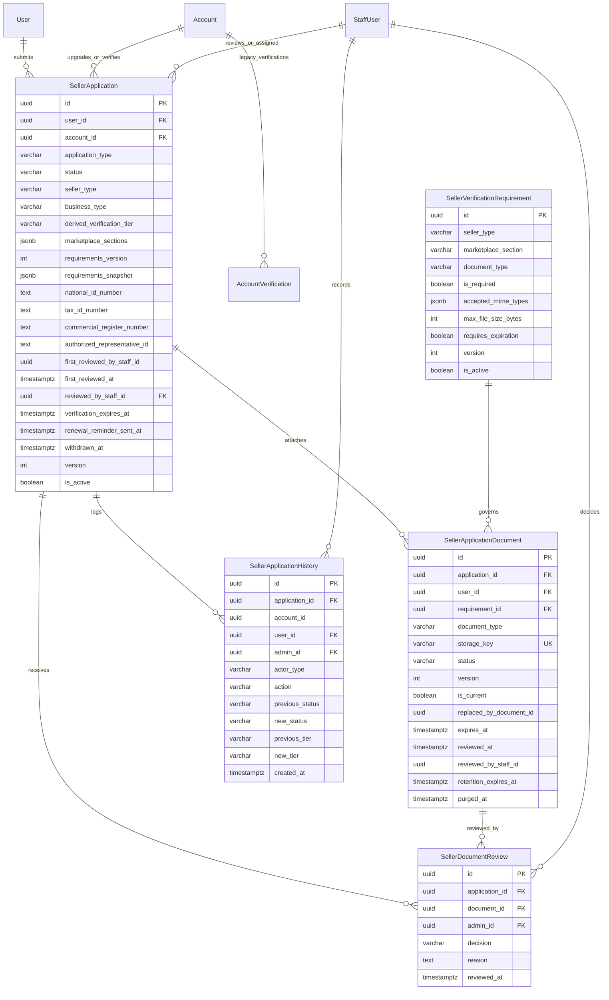
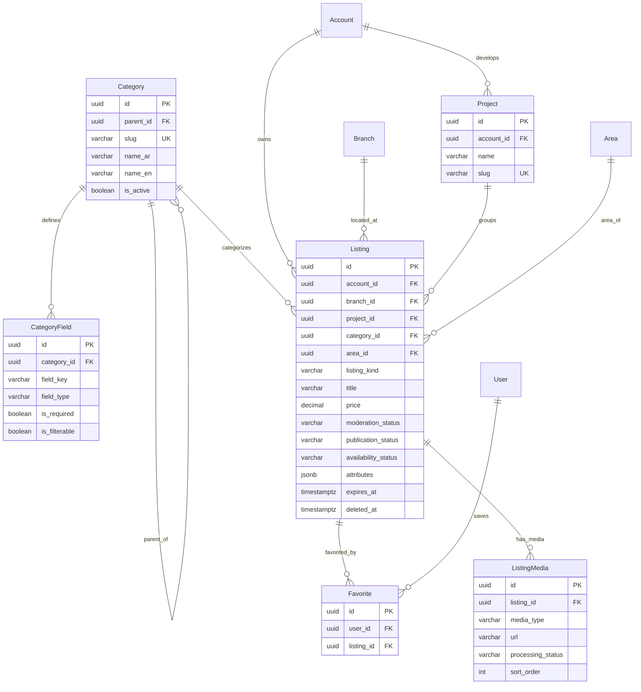
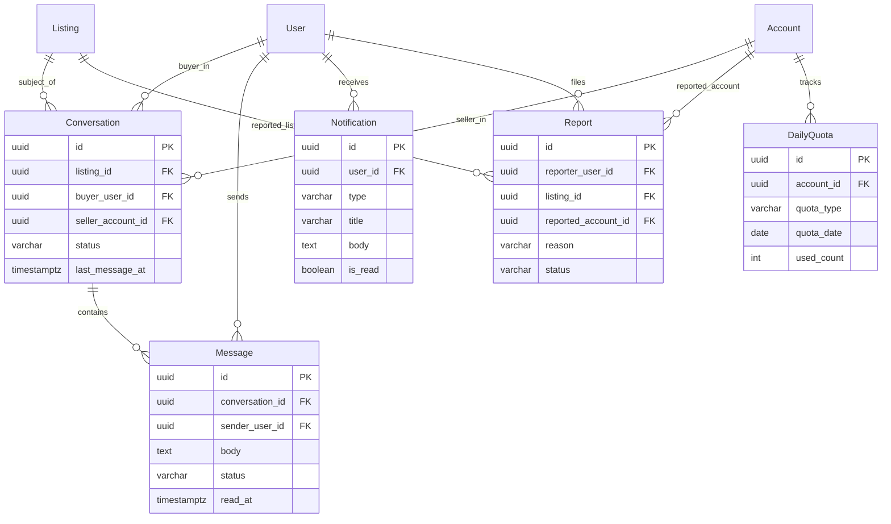
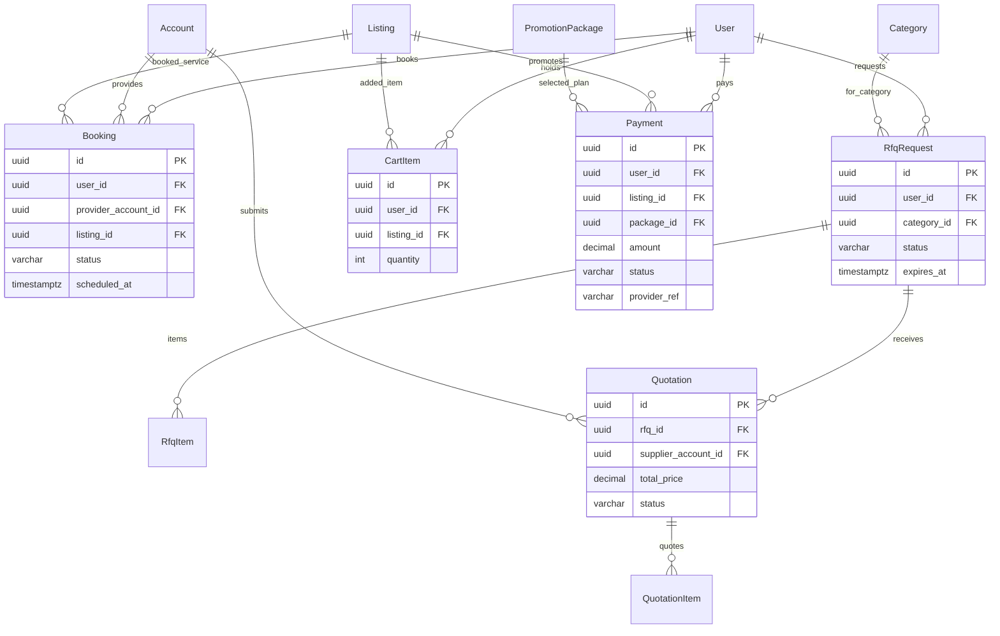
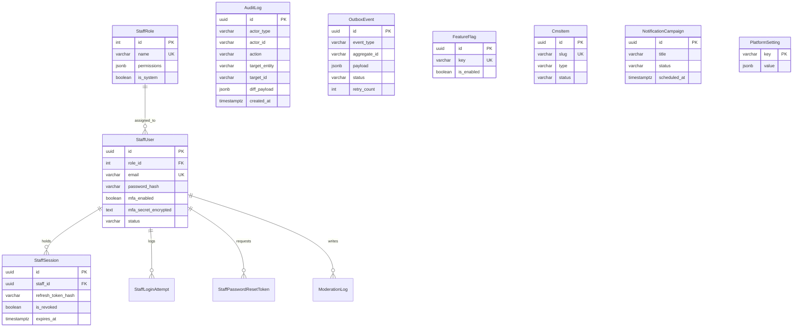

# 06 — Database ERDs by Domain

All entities, keys, cardinalities, unique constraints, and indexes below are derived directly from `backend/prisma/schema.prisma` and Migrations #1–#15.

---

## Domain 1: Accounts, Users, Authentication & Locations

**Key Constraints & Indexes:**
- `AccountMember`: `UNIQUE (account_id, user_id)` (`uq_account_user`)
- `UserDevice`: `UNIQUE (user_id, fcm_token)` (`uq_user_device_token`)
- `ServiceArea`: `UNIQUE (account_id, area_id)` (`uq_service_area`)
- `Branch`: GiST spatial index `idx_branches_location`
- `Account`: `chk_account_verification_status` (`not_submitted`, `pending`, `approved`, `rejected`, `needs_changes`, `suspended`, `expired`), `chk_accounts_seller_type`, `chk_accounts_verification_tier`, index on `(verification_expires_at)`

---

## Domain 2: Seller Verification System

**Key Constraints & Indexes:**
- Partial Unique Index `uq_seller_applications_active_user_type` on `(user_id, application_type)` where `is_active = true AND deleted_at IS NULL AND status IN ('DRAFT','PENDING','UNDER_REVIEW','NEEDS_CORRECTION','APPROVED')`.
- `SellerApplicationDocument`: `UNIQUE (storage_key)`, index on `(retention_expires_at, purged_at)` for retention cleanup worker.

---

## Domain 3: Listings, Categories, Media & Projects

---

## Domain 4: Messaging, Notifications, Reports & Quotas

---

## Domain 5: Activity Hub (Bookings, RFQ, Quotations, Cart) & Payments

---

## Domain 6: Enterprise Admin RBAC, CMS, Campaigns & Outbox

