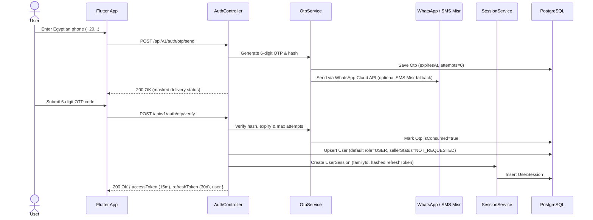
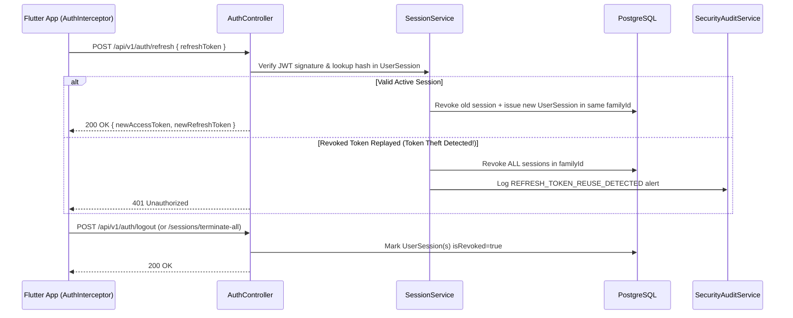
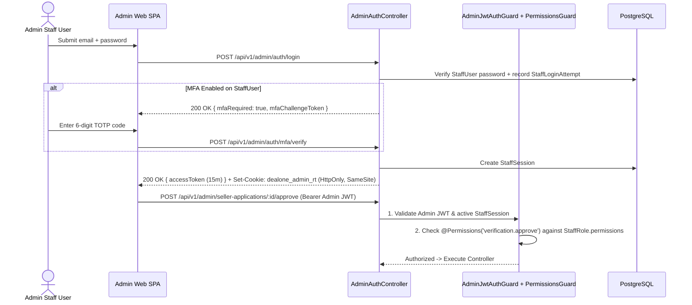

# 07 — Authentication & Authorization Flows

## Overview

Deal One runs **two strictly separated authentication stacks**:
1. **Marketplace User Auth** (`/api/v1/auth/*` via `AuthModule`, `JwtAuthGuard`, `UserSession` with refresh token family rotation & reuse detection).
2. **Enterprise Admin Auth** (`/api/v1/admin/auth/*` via `AdminAuthModule`, `AdminJwtAuthGuard`, `PermissionsGuard`, `StaffSession`, HttpOnly refresh cookie, and TOTP MFA).

---

## A. Marketplace OTP Registration / Login & Password Login

*Note: Password login (`POST /api/v1/auth/password/login` / `POST /api/v1/auth/login`), password set/change (`POST /password/set`, `POST /password/change`), and forgot/reset (`POST /password/forgot`, `POST /password/reset`) are all implemented in `AuthController` using bcrypt password hashing and OTP verification.*

---

## B. Refresh Token Rotation, Reuse Detection & Logout

---

## C. Admin Login, TOTP MFA & RBAC Guard Pipeline

## Authorization Layers Summary

| Guard | Protects | Verified Source |
| :--- | :--- | :--- |
| `JwtAuthGuard` | Authenticated marketplace user endpoints | `backend/src/modules/auth/guards/jwt-auth.guard.ts` |
| `SellerAuthorizationGuard` | Seller-only actions (`CAN_CREATE_LISTING`, `CAN_ACCESS_SELLER_DASHBOARD`, `CAN_SUBMIT_SELLER_APPLICATION`) | `backend/src/modules/accounts/guards/seller-authorization.guard.ts` |
| `AccountTenantGuard` | Multi-tenant Account ownership & `AccountMember` roles (`owner`, `manager`, `lister`, `responder`) | `backend/src/modules/auth/guards/account-tenant.guard.ts` |
| `AdminJwtAuthGuard` + `PermissionsGuard` | All `/api/v1/admin/*` endpoints using `@Permissions(...)` / `@AnyPermissions(...)` | `backend/src/modules/admin-auth/guards/` |
| `RateLimitGuard` | Brute-force & upload abuse protection backed by Redis Cache | `backend/src/core/guards/rate-limit.guard.ts` |
