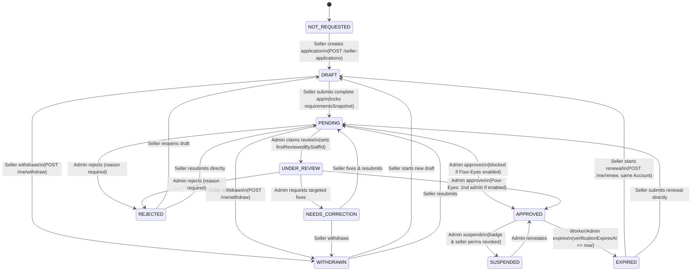
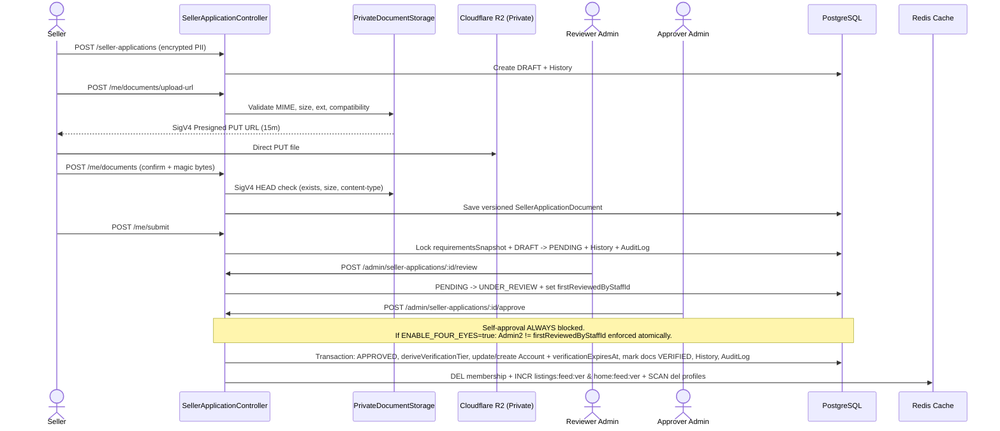

# 08 — Seller Verification Lifecycle

## Overview

Derived directly from `backend/src/modules/accounts/seller-application-state-machine.ts`, `verification-tier.helper.ts`, and `seller-application.service.ts`.

Deal One keeps **Seller Classification** (`INDIVIDUAL`, `BUSINESS`, `SERVICE_PROVIDER`) strictly separate from **Server-Derived Verification Tier** (`NONE`, `IDENTITY_VERIFIED`, `BUSINESS_VERIFIED`).

---

## A. Authoritative State Machine (10 Actual States)



### Account & Badge Impact Mapping

| `SellerApplication.status` | `Account.verificationStatus` | `Account.verificationTier` | Public Badge | Listing Creation |
| :--- | :--- | :--- | :--- | :---: |
| `NOT_REQUESTED` / `DRAFT` / `WITHDRAWN` | `not_submitted` | `NONE` | `null` | Blocked |
| `PENDING` / `UNDER_REVIEW` | `pending` | `NONE` | `null` | Blocked |
| `NEEDS_CORRECTION` | `needs_changes` | `NONE` | `null` | Blocked |
| `REJECTED` | `rejected` | `NONE` | `null` | Blocked |
| `APPROVED` (Individual / Service Provider) | `approved` | `IDENTITY_VERIFIED` | **هوية موثقة** | Allowed |
| `APPROVED` (Business) | `approved` | `BUSINESS_VERIFIED` | **شركة / مكتب موثق** | Allowed |
| `SUSPENDED` | `suspended` | `NONE` | `null` (Revoked) | Blocked *(buyer perms kept)* |
| `EXPIRED` | `expired` | `NONE` | `null` (Revoked) | Blocked *(buyer perms kept)* |

*Business Upgrade Invariant: While a `BUSINESS_UPGRADE` application is `DRAFT`, `PENDING`, `UNDER_REVIEW`, `NEEDS_CORRECTION`, `REJECTED`, or `WITHDRAWN`, the seller's existing `Account`, `IDENTITY_VERIFIED` badge, listings, branches, members, and conversations remain completely untouched.*

---

## B. Sequence: Submission, Four-Eyes Review & Approval



---

## C. Sequence: Expiration & Same-Account Renewal

```mermaid
sequenceDiagram
    participant Worker as SellerVerificationMaintenanceProcessor
    participant DB as PostgreSQL
    participant Redis as Redis Cache
    actor Seller
    participant API as SellerApplicationController

    Worker->>DB: Hourly scan: APPROVED & verificationExpiresAt <= now
    Worker->>DB: Atomic APPROVED -> EXPIRED, Account -> expired / NONE, schedule doc retention
    Worker->>Redis: Invalidate account, profile & feed caches
    Worker-->>Seller: Push: SELLER_VERIFICATION_EXPIRED

    Seller->>API: POST /api/v1/seller-applications/me/renew
    API->>DB: EXPIRED -> DRAFT (same accountId preserved; valid non-expired docs kept; expired docs marked isCurrent=false)
    Note over Seller,DB: Existing listings, branches, members & conversations remain intact.<br/>Badge stays NONE until Admin approves renewed submission.
```
