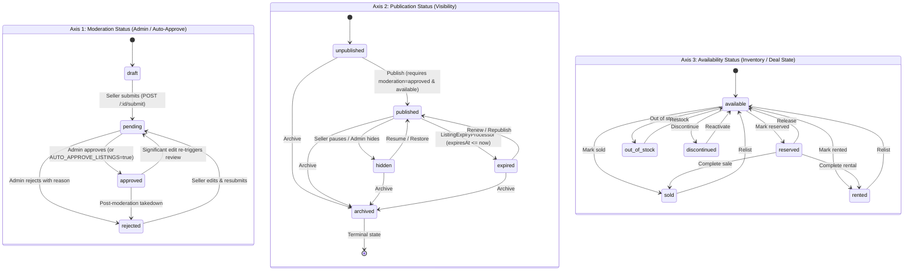
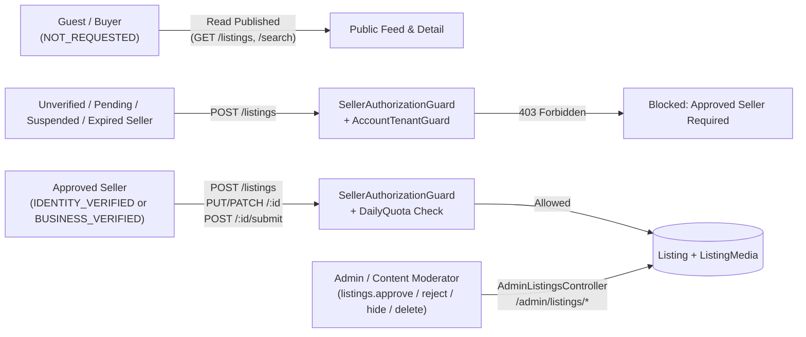

# 09 — Listing / Advertisement Lifecycle

## Overview

Deal One implements an **Orthogonal 3-Axis Listing State Machine** (`backend/src/modules/listings/listings-state-machine.ts`) decoupling **Moderation**, **Publication**, and **Availability**.

**Public Visibility Rule:** A listing appears in public buyer search/home feeds **if and only if**:
`moderationStatus == 'approved' AND publicationStatus == 'published' AND availabilityStatus == 'available'`.

---

## A. Three Orthogonal State Machines

---

## B. Role & Seller Verification Gate Impact on Listings

### Key Listing Invariants Verified in Code
- **Seller Gate:** `POST /api/v1/listings`, `PUT/PATCH /api/v1/listings/:id`, `DELETE /api/v1/listings/:id`, and `POST /api/v1/listings/:id/submit` require an active, approved seller (`SellerAuthorizationGuard`) and valid `AccountMember` permission (`owner`, `manager`, or `lister`).
- **Feed Cache Invalidation:** Creating, editing, moderating, or changing seller verification status bumps Redis version keys `listings:feed:ver` and `home:feed:ver`.
- **Soft Delete:** Deleting a listing sets `deletedAt` while preserving historical conversations, reports, and bookings.
