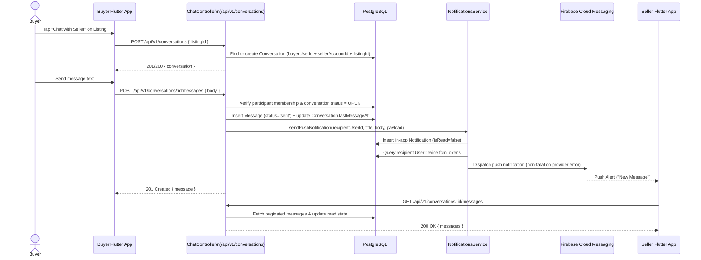
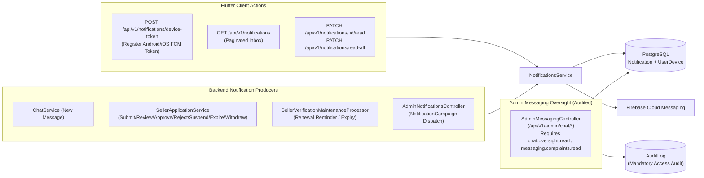

# 10 — Messaging & Notifications Architecture

## Overview

As verified directly in `backend/src/modules/chat/` and `backend/src/modules/notifications/`:
- **Messaging is REST-based** (`/api/v1/conversations/*`). There is **NO WebSocket gateway** in the current codebase; the Flutter app loads and refreshes messages over HTTPS REST and receives new-message alerts via **Firebase Cloud Messaging (FCM)** push notifications.
- **Notifications** combine persistent PostgreSQL `Notification` records (in-app inbox with read/read-all endpoints) and `firebase-admin` FCM push delivery to registered `UserDevice` tokens.

---

## A. Conversation Creation, Message Send & Push Notification Flow

---

## B. In-App Notification Inbox, Device Tokens & Admin Oversight

## Planned / Future (Not Implemented Yet)
- WebSocket / SSE real-time messaging gateway for live typing indicators and instant read receipts without REST polling.
