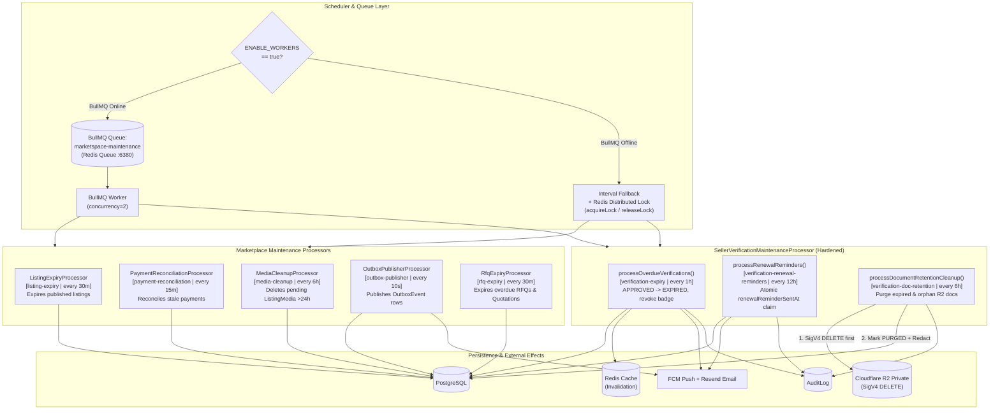

# 11 — Background Jobs & Scheduled Workers

## Overview

Derived directly from `backend/src/workers/worker.service.ts`, `worker.module.ts`, and all 7 processor files.

`WorkerService` is controlled by `ENABLE_WORKERS` (default `true`). When the Redis Queue client (`6380`) is connected, it registers **8 BullMQ repeatable jobs** on the `marketspace-maintenance` queue (concurrency `2`, multi-replica safe). If BullMQ is unavailable, it gracefully falls back to `setInterval` timers guarded by Redis distributed locks (`SET NX EX`).

## Architecture Diagram

## Job Schedule, Safety & Retry Matrix

| BullMQ Job Name | Schedule | Processor | DB / External Effects | Failure & Retry Safety |
| :--- | :--- | :--- | :--- | :--- |
| `outbox-publisher` | Every `10s` | `OutboxPublisherProcessor` | Reads pending `OutboxEvent`, dispatches emails/events | Per-event error isolation; increments retry count |
| `payment-reconciliation` | Every `15m` | `PaymentReconciliationProcessor` | Reconciles pending `Payment` records | Catches errors; logs & retries next cycle |
| `listing-expiry` | Every `30m` | `ListingExpiryProcessor` | `Listing.publicationStatus -> expired` where `expiresAt <= now` | Idempotent batch query |
| `rfq-expiry` | Every `30m` | `RfqExpiryProcessor` | Expires overdue `RfqRequest` & `Quotation` rows | Idempotent batch query |
| `verification-expiry` | Every `1h` | `SellerVerificationMaintenanceProcessor` | `SellerApplication -> EXPIRED`, `Account -> expired / NONE`, invalidates Redis, pushes notification | Atomic `updateMany(status=APPROVED)` lock; per-app try/catch |
| `verification-doc-retention` | Every `6h` | `SellerVerificationMaintenanceProcessor` | Calls R2 SigV4 `DELETE` **before** DB `PURGED` update; excludes `PENDING`/`UNDER_REVIEW`/`NEEDS_CORRECTION` | Failed R2 delete leaves DB row unpurged for next retry; `404` treated as already deleted |
| `media-cleanup` | Every `6h` | `MediaCleanupProcessor` | Deletes `ListingMedia` stuck in `pending` > 24h | Safe catch + log |
| `verification-renewal-reminders` | Every `12h` | `SellerVerificationMaintenanceProcessor` | Claims `renewalReminderSentAt: null` atomically; sends push `VERIFICATION_RENEWAL_REMINDER_DAYS` before expiry | Atomic claim prevents duplicate reminders across replicas |

> **Honest Note on Orphan R2 Uploads:** `processDocumentRetentionCleanup()` cleans `PENDING_UPLOAD` rows older than `VERIFICATION_ORPHAN_UPLOAD_TTL_HOURS` (`24h`), while raw unconfirmed R2 uploads (where `POST /me/documents` was never called) require a Cloudflare R2 bucket lifecycle rule in production.
