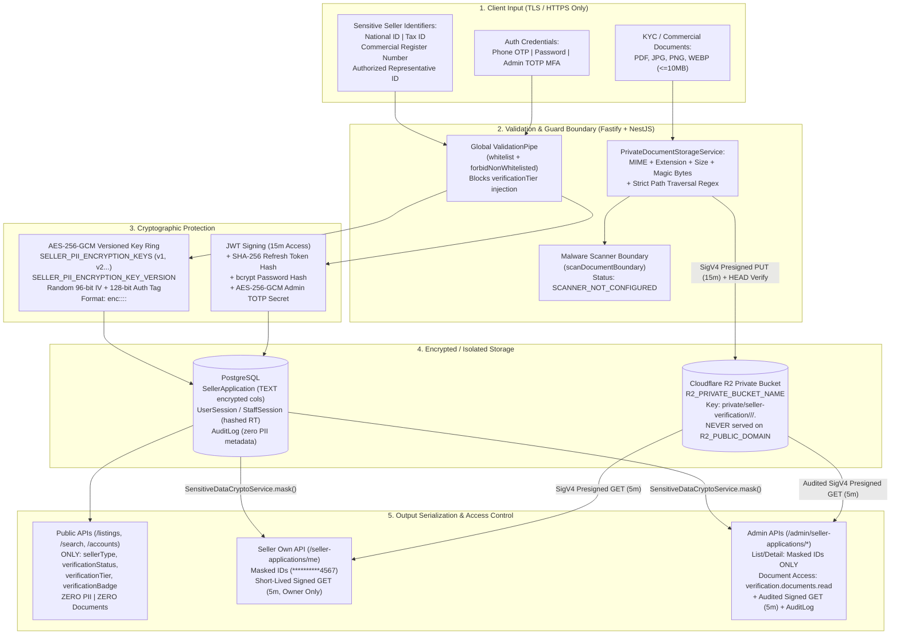

# 12 — Security & Sensitive Data Flow Diagram

## Overview

This diagram maps the end-to-end handling of all sensitive identifiers, KYC verification documents, and authentication tokens verified in `SensitiveDataCryptoService`, `PrivateDocumentStorageService`, `SellerApplicationService`, `SessionService`, and `AdminAuthService`.

> **Security Policy:** Zero secrets, real tokens, or real PII appear in this document.

## Sensitive Data Flow Diagram

## Key Rotation & Privacy Controls

| Control | Implementation | Source File |
| :--- | :--- | :--- |
| **AES-256-GCM Key Rotation** | Comma-separated versioned keys (`SELLER_PII_ENCRYPTION_KEYS="v1:...,v2:..."`); new writes use active version while `v1` and legacy plaintext remain readable; `needsReencryption()` + `reencrypt()` support idempotent migration. | `sensitive-data-crypto.service.ts` |
| **Tamper Detection** | GCM auth tag failure or unknown key version returns `ok: false` without throwing or logging plaintext/ciphertext; `mask()` returns `'********'`. | `sensitive-data-crypto.service.ts` |
| **Admin Masking** | `nationalIdNumber`, `taxIdNumber`, `commercialRegisterNumber`, and `authorizedRepresentativeId` are masked in user responses, admin list responses, and admin detail responses. | `seller-application.service.ts` |
| **Refresh Token Reuse Detection** | Replaying a revoked refresh token revokes the entire `familyId` session tree and logs a high-severity security alert. | `session.service.ts` |
| **Malware Scanner Status** | **Not active yet.** `scanDocumentBoundary()` returns `SCANNER_NOT_CONFIGURED`; MIME, extension, size, magic-byte, and R2 `HEAD` checks are active. | `private-document-storage.service.ts` |
