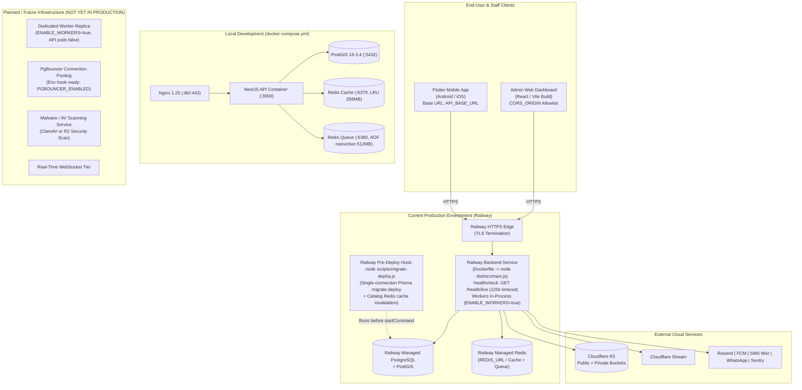

# 13 — Deployment & Infrastructure Architecture

## Overview

This diagram strictly separates **Current Production (Railway)**, **Local Development (Docker Compose)**, and **Planned Infrastructure**, verified directly against `railway.json`, `Dockerfile`, `backend/Dockerfile`, `docker-compose.yml`, and `backend/scripts/migrate-deploy.js`.

## Deployment Diagram

## Runtime Health Checks, Migrations & Env Groups

- **Health Endpoints:**
  - `GET /health/live` — Liveness probe configured in `railway.json` (`healthcheckTimeout: 120`) and `docker-compose.yml`.
  - `GET /health/ready` — Readiness probe verifying PostgreSQL, Redis, and Worker status.
  - `GET /metrics` — Prometheus metrics protected by `METRICS_AUTH_TOKEN` (`MetricsAuthGuard`).
- **Safe Migration Execution (`backend/scripts/migrate-deploy.js`):**
  - Enforces `DIRECT_DATABASE_URL` when PgBouncer is used, sets `connection_limit=1`, redacts credentials from logs, applies all 15 Prisma migrations via local Prisma CLI binary, and invalidates catalog Redis cache.
- **Required Production Env Groups (No Secrets Shown):**
  - Core: `NODE_ENV=production`, `DATABASE_URL`, `DIRECT_DATABASE_URL`, `CORS_ORIGIN`, `TRUST_PROXY`, `JWT_ACCESS_SECRET`, `JWT_REFRESH_SECRET`
  - Admin: `ADMIN_JWT_ACCESS_SECRET`, `ADMIN_MFA_ENCRYPTION_KEY`, `ADMIN_PUBLIC_URL`, `ADMIN_COOKIE_DOMAIN`
  - Verification & Storage: `SELLER_PII_ENCRYPTION_KEYS`, `SELLER_PII_ENCRYPTION_KEY_VERSION`, `R2_ACCOUNT_ID`, `R2_ACCESS_KEY_ID`, `R2_SECRET_ACCESS_KEY`, `R2_BUCKET_NAME`, `R2_PRIVATE_BUCKET_NAME`, `R2_PUBLIC_DOMAIN`, `ENABLE_FOUR_EYES_VERIFICATION_REVIEW`, `VERIFICATION_VALIDITY_DAYS`, `VERIFICATION_DOC_RETENTION_*_DAYS`
  - Gateways: `RESEND_API_KEY`, `FIREBASE_*`, `WHATSAPP_*` / `SMS_MISR_*`, `CLOUDFLARE_STREAM_*`
