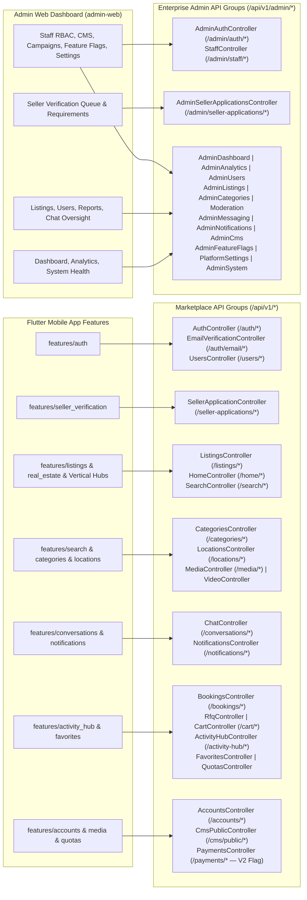

# 14 — API Integration Map

## Overview

All public and authenticated API routes live under `/api/v1/*` (except `/health/*` and `/metrics`), implemented across **38 NestJS controllers** and consumed by **Flutter (`deal one app`)** and **Admin Web (`admin-web`)**.

## High-Level API Group Map

## Detailed Domain Endpoint Summary

| Domain | Base Path | Auth Requirement | Key Endpoints | Flutter / Admin Consumer |
| :--- | :--- | :--- | :--- | :--- |
| **Auth & Email** | `/api/v1/auth` | Public (OTP/Login) + `JwtAuthGuard` | `POST /otp/send`, `/otp/verify`, `/login`, `/password/login`, `/password/forgot`, `/password/reset`, `/refresh`, `/logout`, `GET /me`, `GET /sessions` | `features/auth` |
| **Seller Verification (User)** | `/api/v1/seller-applications` | `JwtAuthGuard` + `SellerAuthorizationGuard` | `GET /requirements`, `POST /`, `GET /me`, `PATCH /me`, `POST /me/documents/upload-url`, `POST /me/documents`, `PUT /me/documents/:id/replace`, `GET /me/documents/:id/access`, `POST /me/submit`, `POST /me/resubmit`, `POST /me/withdraw`, `POST /me/renew`, `POST /me/business-upgrade`, `POST /me/business-upgrade/submit`, `GET /dashboard` | `features/seller_verification` |
| **Seller Verification (Admin)** | `/api/v1/admin/seller-applications` | `AdminJwtAuthGuard` + `PermissionsGuard` | `GET /`, `GET /:id`, `GET /:id/history`, `GET /:id/documents/:docId`, `POST /:id/documents/:docId/review`, `POST /:id/review`, `POST /:id/request-correction`, `POST /:id/approve`, `POST /:id/reject`, `POST /:id/suspend`, `POST /:id/expire`, `POST /:id/reinstate`, `GET/POST/PATCH/DELETE /requirements` | `admin-web` |
| **Listings & Discovery** | `/api/v1/listings`, `/home`, `/search` | Public Read; `JwtAuthGuard` + `SellerAuthorizationGuard` + `AccountTenantGuard` on Write | `GET /listings`, `GET /listings/:id`, `POST /listings`, `PUT/PATCH /listings/:id`, `POST /listings/:id/submit`, `PATCH /listings/:id/availability`, `POST /listings/:id/reveal-contact`, `GET /home`, `GET /search` | `features/listings`, `search`, `real_estate`, vertical hubs |
| **Messaging & Notifications** | `/api/v1/conversations`, `/notifications` | `JwtAuthGuard` | `GET/POST /conversations`, `GET/POST /conversations/:id/messages`, `GET /notifications`, `PATCH /notifications/:id/read`, `PATCH /notifications/read-all`, `POST /notifications/device-token` | `features/conversations`, `features/notifications` |
| **Activity Hub** | `/api/v1/activity-hub`, `/bookings`, `/cart`, `/rfqs` | `JwtAuthGuard` | Bookings lifecycle, RFQ requests & supplier quotations, multi-seller cart, unified activity feed | `features/activity_hub` |
| **Admin Auth & Ops** | `/api/v1/admin/*` | `AdminJwtAuthGuard` + `PermissionsGuard` | `/admin/auth/*` (login, MFA, refresh), `/admin/dashboard`, `/admin/analytics`, `/admin/users`, `/admin/listings`, `/admin/categories`, `/admin/chat`, `/admin/notifications`, `/admin/cms`, `/admin/feature-flags`, `/admin/settings`, `/admin/staff`, `/admin/system` | `admin-web` |
| **Observability** | `/health`, `/metrics` | Public (`/health/live`), `MetricsAuthGuard` (`/metrics`) | `GET /health/live`, `GET /health/ready`, `GET /metrics` | Railway / Monitoring |
