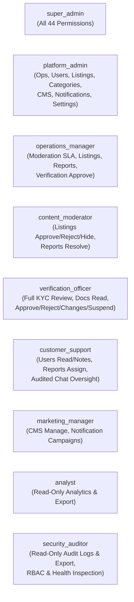

# 15 — User Roles & Permissions Matrix

## Overview

All roles, capabilities, and permissions below are extracted directly from:
- `backend/src/core/enums/domain.enums.ts` (`UserRole`, `AccountMemberRole`, `SellerCapability`)
- `backend/src/modules/accounts/guards/seller-authorization.guard.ts`
- `backend/src/modules/auth/guards/account-tenant.guard.ts`
- `backend/src/modules/admin-auth/constants/admin-permissions.constant.ts` (**9 system Staff Roles**, **44 granular permissions**)

---

## A. Marketplace User & Seller Roles Matrix

| Actor / Role | Read Public Listings & Profiles | Favorites / Chat / Bookings / RFQ / Cart | Submit / Withdraw / Renew Verification | Create / Edit / Submit Listings | Seller Dashboard & Business Upgrade | Access Own KYC Docs (Signed 5m) | Access Other Users' KYC Docs |
| :--- | :---: | :---: | :---: | :---: | :---: | :---: | :---: |
| **Guest (Unauthenticated)** | Yes | No | No | No | No | No | No |
| **Registered Buyer (`USER`, `NOT_REQUESTED`)** | Yes | Yes | Yes (Initial) | No (`403`) | No (`403`) | Own Only | No |
| **Pending / Needs Correction / Rejected Seller** | Yes | Yes | Yes (Edit / Resubmit / Withdraw) | No (`403`) | No (`403`) | Own Only | No |
| **Suspended / Expired Seller** | Yes | Yes *(buyer perms preserved)* | Renew (`EXPIRED`) | No (`403`) | No (`403`) | Own Only | No |
| **Identity Verified Seller (`IDENTITY_VERIFIED`)** | Yes | Yes | Business Upgrade | Yes | Yes | Own Only | No |
| **Business Verified Seller (`BUSINESS_VERIFIED`)** | Yes | Yes | Renewal (on expiry) | Yes (Multi-branch / Team) | Yes | Own Only | No |

### Account Member Sub-Roles (`AccountMember.role`, enforced by `AccountTenantGuard`)

| Member Role | Manage Account / Team | Create / Edit Listings | Respond to Buyer Chat / RFQs |
| :--- | :---: | :---: | :---: |
| `owner` | Yes | Yes | Yes |
| `manager` | Yes | Yes | Yes |
| `lister` | No | Yes | Limited |
| `responder` | No | No | Yes |

---

## B. Enterprise Admin Staff RBAC Matrix (9 System Roles)

### Granular Admin Permission Matrix (Key Domains)

| Staff Role | `users.*` | `listings.*` | `verification.*` | `verification.documents.read` | `chat.oversight.read` | `cms.*` / `notifications.*` | `admins.*` / `roles.*` | `audit_logs.*` |
| :--- | :--- | :--- | :--- | :---: | :---: | :--- | :--- | :--- |
| `super_admin` | Full | Full | Full (+ `requirements.manage`) | Yes (Audited) | Yes (Audited) | Full | Full | Read + Export |
| `platform_admin` | Full | Full | `read` only | No | No | Full | `admins.read` | Read |
| `operations_manager` | Read, Update, Suspend | Read, Approve, Reject, Hide | Read, Approve | No | No | Read / Create | No | Read |
| `content_moderator` | Read | Read, Approve, Reject, Hide | No | No | No | No | No | Read |
| `verification_officer` | Read | No | Read, Review, Approve, Reject, Require Changes, Suspend | Yes (Audited) | No | No | No | Read |
| `customer_support` | Read, Update | Read | `read` only | No | Yes (Audited) | `notifications.read` | No | No |
| `marketing_manager` | No | Read | No | No | No | CMS Full + Notif Create/Send | No | No |
| `analyst` | Read | Read | No | No | No | Read | No | No |
| `security_auditor` | Read | Read | `read` only | No | No | No | `admins.read`, `roles.read` | Read + Export |

### Special Verification Governance Guards
- **Self-Approval Prohibited:** No staff member (not even `super_admin`) can review, approve, reject, or suspend their own seller application (`403 SELF_APPROVAL_FORBIDDEN`).
- **Four-Eyes Separation of Duties:** When `ENABLE_FOUR_EYES_VERIFICATION_REVIEW=true`, final approval requires an initial reviewer (`firstReviewedByStaffId`) AND a **different** approving admin (`403 FOUR_EYES_APPROVAL_REQUIRED`).
- **Sensitive Document Access:** Viewing any KYC document via `GET /api/v1/admin/seller-applications/:id/documents/:docId` requires `verification.documents.read`, issues a 5-minute signed URL, and writes an immutable `AuditLog` entry.
